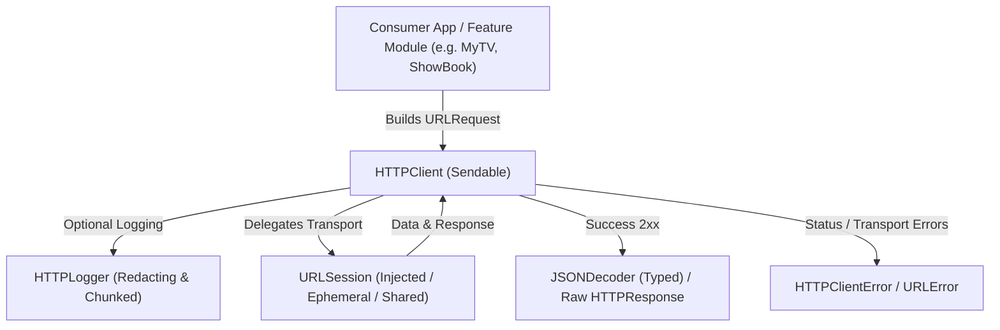

# CommonNetworkingKit

A lightweight, Foundation-only Swift package providing a secure, concurrent HTTP transport layer and optional typed JSON decoding. Extracted and adapted from [Anurag Chourasia's MyTV and ShowBook apps](https://github.com/Anurag-Chourasia).


---

## Architecture



`CommonNetworkingKit` is architected with strict separation of concerns, zero external third-party dependencies, and pure Swift 6 concurrency compliance:

1. **Transport Abstraction**:
   - `HTTPClientProtocol`: Exposes `send(_ request: URLRequest) async throws -> HTTPResponse` and `request<T: Decodable>(_ request: URLRequest, as type: T.Type, decoder: JSONDecoder) async throws -> T`.
   - `HTTPClient`: Thread-safe, `Sendable` implementation delegating work to an injected or default `URLSession`.
2. **Deterministic Response Handling**:
   - `HTTPResponse`: Retains immutable `data`, the full `HTTPURLResponse`, status code, and header fields without lossy conversion.
   - `HTTPClientError`: Explicitly discriminates non-HTTP responses, unsuccessful status codes (`unsuccessfulStatus`), and empty payloads (`emptyBody`), retaining the underlying response for inspection.
3. **Privacy-Preserving Diagnostics**:
   - `HTTPLogger`: High-performance structured logger with UUID pairing, elapsed millisecond duration, and recursive case-insensitive sanitization for sensitive credentials, authorization tokens, cookies, passwords, and emails.
4. **Swift 6 Concurrency & Actor Safety**:
   - Built with `-strict-concurrency=complete`. All core types conform to `Sendable`. Decoders are instantiated freshly per call to prevent data races.

> [!NOTE]
> For backward compatibility, the `CommonNetworking` library product and module name are preserved as an alias.

---

## Use Cases

- **Modern REST API Consumption**: Execute async HTTP calls and decode responses directly to Swift `Decodable` models without third-party frameworks like Alamofire.
- **Micro-payloads & Status Code Inspection**: Consume non-JSON or status-only endpoints (e.g., `204 No Content`, Webhooks, binary image downloads) safely using the raw `send(_:)` pipeline.
- **Enterprise-Grade Logging & Audit**: Opt-in diagnostic logging that guarantees no sensitive user authentication headers, query parameters, or payload keys are emitted to logs.
- **100% Deterministic Unit Testing**: Inject `URLSession` with custom `URLProtocol` stubs to test network edge cases (offline state, rate-limiting, cancellation, server errors) without live network calls.

---

## Practical Code Examples

### 1. Typed JSON Request

```swift
import CommonNetworkingKit
import Foundation

struct UserProfile: Decodable, Sendable {
    let id: String
    let name: String
    let email: String
}

final class UserService {
    private let client: HTTPClient

    init(client: HTTPClient = HTTPClient()) {
        self.client = client
    }

    func fetchUserProfile(userId: String) async throws -> UserProfile {
        guard let url = URL(string: "https://api.example.com/v1/users/\(userId)") else {
            throw URLError(.badURL)
        }
        var request = URLRequest(url: url)
        request.setValue("application/json", forHTTPHeaderField: "Accept")
        
        return try await client.request(request, as: UserProfile.self)
    }
}
```

### 2. Raw Response & Status Validation

```swift
func downloadAsset(from url: URL, using client: HTTPClient) async throws -> Data {
    let request = URLRequest(url: url)
    let response = try await client.send(request)
    
    guard (200..<300).contains(response.statusCode) else {
        throw HTTPClientError.unsuccessfulStatus(response)
    }
    return response.data
}
```

### 3. Diagnostic Logging with Custom Redactions

```swift
#if DEBUG
let logger = HTTPLogger(
    additionalSensitiveKeys: ["accountNumber", "ssn", "creditCardNumber"],
    output: { logMessage in
        print(logMessage)
    }
)
let client = HTTPClient(logger: logger)
#else
let client = HTTPClient(logger: nil)
#endif
```

### 4. Deterministic Unit Testing with URLProtocol

```swift
import XCTest
import CommonNetworkingKit

final class MockProtocol: URLProtocol {
    override class func canInit(with request: URLRequest) -> Bool { true }
    override class func canonicalRequest(for request: URLRequest) -> URLRequest { request }
    override func startLoading() {
        let response = HTTPURLResponse(url: request.url!, statusCode: 200, httpVersion: nil, headerFields: nil)!
        client?.urlProtocol(self, didReceive: response, cacheStoragePolicy: .notAllowed)
        client?.urlProtocol(self, didLoad: Data(#"{"id":"123","name":"Anurag","email":"test@example.com"}"#.utf8))
        client?.urlProtocolDidFinishLoading(self)
    }
    override func stopLoading() {}
}

// In test method:
let config = URLSessionConfiguration.ephemeral
config.protocolClasses = [MockProtocol.self]
let client = HTTPClient(session: URLSession(configuration: config))
```

---

## Release Version Controlling

`CommonNetworkingKit` strictly adheres to [Semantic Versioning (SemVer 2.0.0)](https://semver.org/spec/v2.0.0.html):

| Change Level | Policy | Tag Convention |
| :--- | :--- | :--- |
| **MAJOR** (`X.0.0`) | Breaking public API or behavior modifications | `vX.0.0` |
| **MINOR** (`1.X.0`) | Backward-compatible features, new endpoints/helpers | `v1.X.0` |
| **PATCH** (`1.1.X`) | Bug fixes, performance tuning, non-breaking fixes | `v1.1.X` |

- **Release Tracking**: All modifications must be documented in [CHANGELOG.md](CHANGELOG.md).
- **Tag Validation**: Release tags follow the `vX.Y.Z` format and are verified locally and in CI using `bash Scripts/verify-release-version.sh`.
- **SPM Integration**:
  ```swift
  .package(url: "https://github.com/Anurag-Chourasia/CommonNetworkingKit.git", exact: "1.1.0")
  ```

---

## Quality & CI Verification

Every pull request and push to `main` undergoes automated verification before merging:

1. **SwiftLint Gate**:
   - Enforces the organization's pinned 24-rule quality policy (`.swiftlint.yml`, SwiftLint 0.65.1).
   - Zero-tolerance strict mode (`--strict`, warnings treated as errors).
   - Run locally: `bash Scripts/lint.sh`.
2. **Build & Test Gate**:
   - Host target compilation with `-strict-concurrency=complete` and `-warnings-as-errors`.
   - Comprehensive unit tests executed with complete strict concurrency checking.
   - iOS Simulator product verification via `xcodebuild`.

## Canonical module migration

Use the `CommonNetworkingKit` product and `import CommonNetworkingKit`. The legacy `CommonNetworking` product and re-export target have been removed in this candidate and require a breaking release. Replace qualified references such as `CommonNetworking.HTTPClient` with `CommonNetworkingKit.HTTPClient` and update test-support manifests as well as app product references. Repository identity and Git URL do not change merely because the Swift module name changes.
