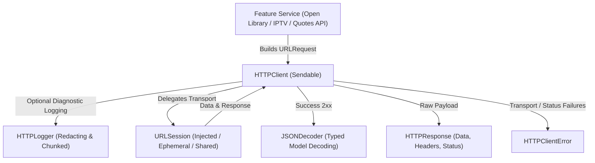
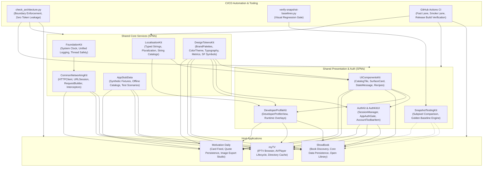

# CommonNetworkingKit

A lightweight, Foundation-only Swift package providing a secure, concurrent HTTP transport layer, redacting telemetry, and typed JSON decoding for multi-app architectures.


-success)


---

## 1. Executive Summary & Purpose

`CommonNetworkingKit` establishes an enterprise-grade, deterministic HTTP networking engine across **ShowBook**, **myTV**, and **Motivation Daily**. It replaces third-party dependencies with native Swift Concurrency (`async`/`await`) and injected `URLSession` instances.

### Key Engineering Objectives:
- **Clean Transport Abstraction**: `HTTPClientProtocol` provides a minimal interface separating raw HTTP transport (`send(_:)`) from typed model parsing (`request(_:as:decoder:)`).
- **Deterministic Error Handling**: `HTTPClientError` explicitly classifies transport timeouts, non-2xx status codes (`unsuccessfulStatus`), and empty payloads (`emptyBody`), retaining the raw HTTP response for error diagnostics.
- **Privacy-Preserving Telemetry**: `HTTPLogger` automatically redacts sensitive headers (e.g. `Authorization`, `Cookie`, `Set-Cookie`) and secret query parameters before logging.
- **100% Deterministic Testing**: Injected `URLSession` allows mock `URLProtocol` handlers to simulate offline states, 429 rate-limits, and payload corruptions without network calls.

---

## 2. Architecture & Design Principles



### Architectural Tenets:
1. **Swift 6 Strict Concurrency**: All core networking interfaces, responses, and errors conform to `Sendable`. Decoders are instantiated per-call to eliminate data races.
2. **Zero Third-Party Dependencies**: Built exclusively on Apple's `Foundation` SDK.
3. **No Hidden State or Caches**: The client acts as a pure transport engine; cache lifecycles and persistence policies remain under caller ownership.

---

## 3. Dependency Graph & Consumer Matrix

| Direction | Package / Project | Responsibility |
|---|---|---|
| **Upstream Dependencies** | **FoundationKit** (`v0.2.0`) | Logging protocols and time measurement utilities. |
| **Downstream Consumers** | **ShowBook** | Powers Open Library book search, work/edition details, and cover downloads. |
| | **myTV** | Powers IPTV-org channel listings, stream verification, and broadcast categories. |
| | **Motivation Daily** | Powers multi-provider quote fetching (`Quotable`, `ZenQuotes`, `AdviceSlip`). |

---

## 4. API Contracts & Practical Code Examples

### 1. Typed Model Request with Error Handling
```swift
import Foundation
import CommonNetworkingKit

struct BookSearchService {
    private let client: HTTPClientProtocol

    init(client: HTTPClientProtocol = HTTPClient()) {
        self.client = client
    }

    func searchBooks(query: String) async throws -> SearchResultsDTO {
        var components = URLComponents(string: "https://openlibrary.org/search.json")!
        components.queryItems = [URLQueryItem(name: "q", value: query)]

        let request = URLRequest(url: components.url!)
        
        do {
            return try await client.request(request, as: SearchResultsDTO.self)
        } catch let HTTPClientError.unsuccessfulStatus(status, response) {
            print("Server returned HTTP \(status): \(response)")
            throw BookServiceError.serverFailure(statusCode: status)
        } catch {
            throw BookServiceError.networkUnavailable
        }
    }
}
```

### 2. Testing with Custom `URLProtocol` Stubs
```swift
import XCTest
import CommonNetworkingKit

final class NetworkTests: XCTestCase {
    func testOfflineSimulation() async {
        let configuration = URLSessionConfiguration.ephemeral
        configuration.protocolClasses = [MockURLProtocol.self]
        let session = URLSession(configuration: configuration)
        let client = HTTPClient(session: session)

        MockURLProtocol.stubError = URLError(.notConnectedToInternet)

        let request = URLRequest(url: URL(string: "https://api.example.com/data")!)
        
        do {
            _ = try await client.send(request)
            XCTFail("Expected failure")
        } catch {
            XCTAssertTrue(error is URLError)
        }
    }
}
```

---

## 5. Verification & Testing

```sh
# Run networking client, redacting logger, and decoder tests
swift test

# Validate swiftlint strict rules
swiftlint lint --strict
```

---

## 6. End-to-End Ecosystem Connectivity



---

## 7. Canonical Notion Dashboards & Governance Links

- [iOS Portfolio — Engineering Tickets Dashboard](https://app.notion.com/p/c20d7f4b133b44499c8ac0b4d5f6249e?pvs=204)
- [iOS Portfolio — Master Document](https://app.notion.com/p/40ffa5f855b98192ad2ede66a5d36fe7)
- [Architecture Boundary Validator (`check_architecture.py`)](file:///Users/anuragchourasia/Desktop/Projects/UIComponentsKit/Scripts/check_architecture.py)
- [Release & Gate Policy Documentation (`Docs/MASTER.md`)](file:///Users/anuragchourasia/Desktop/Projects/Docs/MASTER.md)
